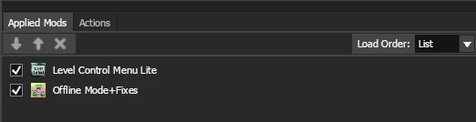

### Running GardenGate on Linux

### Apply the protonfix (Required for all games)

Use CachyOS/GE-proton or some other proton fork otherwise the fix files won't work (You can do the same things the fix file does if you really want to use valve proton)

Put all the [localfixes](../Container/localfixes) into `~/.config/protonfixes/localfixes` and set `GAMEID=umu-gardengate` in your launcher if you're using any launcher other than steam. Set `PROTONFIXES_DISABLE=1` if you'd like to disable the fix. 

If you're using the official epic games launcher set `GAMEID=1922560` globally as it doesn't support gamefixes or per-game environment variables yet. I've asked the team at epic to implement that, and they said they will so stay tuned perhaps. EGS Launcher support is very much work in progress due to there being no testers for it (please contact me on discord/fluxer if you own one of the games on epic games launcher)

### Extract relative to the game folder
Extract GardenGate.zip from releases to <GameDir>/GardenGate . This is required if you own the game on anything other than the EA Launcher.

# Garden warfare 1
### 1. Install the game
* Install the game from ea app, launch it once

### 2. Download the latest release
Run the launcher > go to patcher and press apply patch

- Launch via the launcher

# Garden warfare 2/Battle for Neighborville
### 1. Install the game
* Install the game from your platform, launch it once
* If prompted about the anti-cheat, select `Yes`
* You should receive an error message like `wine not supported` - click OK


### 2. Downgrade your game
Run the launcher > go to patcher and press apply patch

### 3. Install the mods in the right order (Only needed if you want stars in gw2)
Use [this frosty mod manager](https://www.nexusmods.com/masseffectandromeda/mods/1190?tab=files&file_id=6904) instead of the stock one as the stock one doesn't work with wine. Get the mods for gw2 [here](../Mods/gw2/GardenGate.fbpack)



### 4. Launch the game through the launcher

### Disclaimer about machines with low ram

If your frosty crashes due to oom when installing large mods run this;
```sh
systemctl disable --now systemd-oomd
systemctl stop --now systemd-oomd
systemctl mask systemd-oomd
```

# Hosting as dedicated server
See [this](./LINUX_DEDICATED.md)
