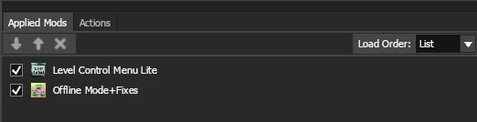

# Running dedicated server on Linux

### Prerequisites

Warning: Run everything here within a tmux session if you'd like it to continue running once you log out of ssh

Ensure the following dependencies are installed on your host:

* podman
* tmux
* git
* text editor (e.g. vim)
* a windows pc or a linux machine with some sort of DE/WM (needed to generate the token/install mods)

### Generating `auth.toml`

> [!WARNING]
Do this on a linux machine with a desktop environment or a windows pc due to the need to run a browser to login. ([See this issue](https://github.com/ArmchairDevelopers/Maxima/issues/53) )

Note: If you have a browser that supports enhanced tracking protection (e.g. LibreWolf), you might need to turn that off for the login to work properly.

Download the pre-release version of maxima from [here](https://github.com/sjp761/maxima/releases)

After logging in, locate the generated `auth.toml` file:

- Windows:
  `%APPDATA%\Roaming\ArmchairDevelopers\Maxima\data`

* Linux:
  `$HOME/.local/share/maxima`

Copy `auth.toml` into `Container` folder inside the repository.

### Podman Setup

On the machine that will host the dedicated server, execute the following commands individually:

```sh
mkdir -p $HOME/Games/GardenGate
git clone https://github.com/nocss42/GardenGate $HOME/Projects/GardenGate
cd $HOME/Projects/GardenGate/Container
vim auth.toml   # Paste the contents from your main machine
vim tmux.conf   # Optional (uncomment from Containerfile if used)
podman build --no-cache -t gardengate:latest .
```

### Running the Container

Run the container with:

```sh
podman run --replace -it \
  --name gardengate \
  -v "$HOME/Games/GardenGate:/home/maxima/Games:rw" \
  --device /dev/dri \
  -p 25200:25200/tcp \
  -p 25200:25200/udp \
  -p 27200:27200/tcp \
  -p 27200:27200/udp \
  --security-opt seccomp=unconfined \
  gardengate:latest
```

Type exit once it gets into a shell.

Start the container by running

```sh
podman start -ai gardengate
```

### Game Directory Setup

Create the dir for the game you're going to install:

e.g.

```sh
mkdir -p $HOME/Games/gw2 $HOME/Games/gw2_pfx
```

Install the game via maxima:

```sh
wlheadless-run -c cage -- $HOME/maxima.sh
```

(Press `Ctrl+C` once completed. Should see `[maxima_cli] - Installation finished!`)

### Patch the game

Patch the game by running;

```sh
curl -L https://github.com/nocss42/GardenGate/releases/latest/download/GardenGate.zip \
     -o $HOME/Games/GardenGate.zip
unzip $HOME/Games/GardenGate.zip -d $HOME/Games/GardenGate
wlheadless-run -c cage -- umu-run $HOME/Games/GardenGate/GardenGate_Launcher.exe -patch gw2 $HOME/Games/gw2
```

### Server Configuration

Edit server settings as you wish (We still haven't implemented this) :

```sh
vim /home/maxima/Games/gw2/Settings.txt
```

### Executable names
```
PVZ.Main_Win64_Retail.exe
GW2.Main_Win64_Retail.exe
PVZBattleforNeighborville.exe
```

### Maxima slugs
```
plants-vs-zombies-garden-warfare
plants-vs-zombies-garden-warfare-2
pvz-battle-for-neighborville
```

Launch the server;

```sh
wlheadless-run -c cage -- maxima-cli launch \
  --game-path "$HOME/Games/gw2/GW2.Main_Win64_Retail.exe" \
  --game-args=-server plants-vs-zombies-garden-warfare-2
```

### Installing mods (Required for gw2)

Get a VPS with RDP setup or use waypipe (Frosty CLI is still way too WIP to be of use)

### Depending on the specs of the vps (8gb ram or lower) you might need to add swap like so in order for it to not crash during the initial caching process.

```sh
sudo fallocate -l 8G /swapfile
sudo chmod 600 /swapfile
sudo mkswap /swapfile
sudo swapon /swapfile
echo '/swapfile none swap defaults 0 0' | sudo tee -a /etc/fstab > /dev/null
```

Download frosty inside the container like so;

```sh
# GW1
wget -O $HOME/Games/GW1_FrostyModManager.zip https://github.com/Twig6943/FrostyToolsuiteGW1Linux/releases/latest/download/PVZGW_FrostyModManager.zip
mkdir -p $HOME/Games/GW1_FrostyModManager
unzip $HOME/Games/GW1_FrostyModManager.zip -d $HOME/Games/GW1_FrostyModManager

# GW2
wget -O $HOME/Games/GW2_FrostyModManager.zip https://github.com/nocss42/GardenGate/releases/download/frosty.mirror/FrostyModManager-1190-1-0-6-3-s-1753719610.zip
mkdir -p $HOME/Games/GW2_FrostyModManager
unzip $HOME/Games/GW2_FrostyModManager.zip -d $HOME/Games/GW2_FrostyModManager

# BFN
wget -O $HOME/Games/BFN_FrostyModManager.zip https://github.com/Twig6943/FrostyToolsuiteBFNLinux/releases/latest/download/FrostyModManager.zip
mkdir -p $HOME/Games/BFN_FrostyModManager
unzip $HOME/Games/BFN_FrostyModManager.zip -d $HOME/Games/BFN_FrostyModManager
```

Outside of podman (if you're using waypipe do not use tmux in this part as waypipe seems to not work through tmux, see [this](https://gitlab.freedesktop.org/mstoeckl/waypipe/-/work_items/180) ), run frosty mod manager like so

> [!WARNING]
Get wine mono [here](https://dl.winehq.org/wine/wine-mono/) if it's not packaged for your distro (only needed if you're gonna use wine)

```sh
export DISPLAY="" # only set this if you're using wine
wine taskmgr # run frosty through taskmgr as otherwise it'll not run with waypipe

export PROTON_ENABLE_WAYLAND=1
export PROTONPATH=GE-Proton
umu-run taskmgr # run frosty through taskmgr as otherwise it'll not run with waypipe
```

Don't forget to load the mods in this order;



To start modded server, inside the container run;
```sh
wlheadless-run -c cage -- \
  maxima-cli launch \
  --game-path "$HOME/Games/gw2/GW2.Main_Win64_Retail.exe" \
  --game-args="-server" \
  --game-args="-dataPath" \
  --game-args="ModData/Default" \
  plants-vs-zombies-garden-warfare-2
```
