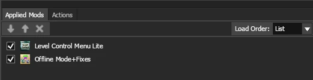

# Running dedicated server on Linux

### Prerequisites

Warning: Run everything here within a tmux session if you'd like it to continue running once you log out of ssh

Ensure the following dependencies are installed on your host:

* podman
* tmux
* git
* text editor (e.g. vim)

### Generating `auth.toml`

Download the pre-release version of maxima from [here](https://github.com/silkker/MARNE/releases/tag/0.1)

After logging in, locate the generated `auth.toml` file:

- Windows:
  `%APPDATA%\Roaming\ArmchairDevelopers\Maxima\data`

* Linux:
  `$HOME/.local/share/maxima`

Copy the contents of `auth.toml` into the same `auth.toml` inside the repository.

### Podman Setup

On the machine that will host the dedicated server, execute the following commands individually:

```sh
mkdir -p $HOME/Games
git clone https://github.com/nocss42/GardenGate
cd GardenGate/Container
vim auth.toml   # Paste the contents from your main machine
vim tmux.conf   # Optional (uncomment from Containerfile if used)
podman build --no-cache -t gardengate:latest .
```

### Running the Container

Run the container with:

```sh
podman run --replace -it \
  --name gardengate \
  -v $HOME/Games:/home/maxima/Games \
  --device /dev/dri \
  -p 25200:25200/tcp \
  -p 25200:25200/udp \
  -p 27200:27200/tcp \
  -p 27200:27200/udp \
  --security-opt seccomp=unconfined \
  gardengate:latest
```

Type exit once it gets into a shell.

Start the container by running

```sh
podman start -ai gardengate
```

### Game Directory Setup

Create the dir for the game you're going to install:

e.g.

```sh
mkdir -p /home/maxima/Games/gw2 /home/maxima/Games/gw2_pfx
```

Install the game via maxima:

```sh
wlheadless-run -c cage -- $HOME/maxima.sh
```

(Press `Ctrl+C` once completed. Should see `[maxima_cli] - Download took x.x`)

### Registry Configuration

Import required registry files:

```sh
WINEPREFIX=/home/maxima/Games/gw2_pfx \
wlheadless-run -c cage -- umu-run regedit \
$HOME/gw2.reg
```

### Patch the game (required for gw2 & bfn)

Patch the game by running;

```sh
curl -L https://github.com/nocss42/GardenGate/releases/latest/download/GardenGate.zip \
     -o /home/maxima/Games/GardenGate.zip
unzip /home/maxima/Games/GardenGate.zip -d /home/maxima/Games/GardenGate
wlheadless-run -c cage -- umu-run /home/maxima/Games/GardenGate/GardenGate_Launcher.exe -patch gw2 /home/maxima/Games/gw2
```

### Server Configuration

Edit server settings as you wish (We still haven't implemented this) :

```sh
vim /home/maxima/Games/gw2/Settings.txt
```

### Executable names
```
PVZ.Main_Win64_Retail.exe
GW2.Main_Win64_Retail.exe
PVZBattleforNeighborville.exe
```

### Maxima slugs
```
plants-vs-zombies-garden-warfare
plants-vs-zombies-garden-warfare-2
pvz-battle-for-neighborville
```

Launch the server;

```sh
wlheadless-run -c cage -- maxima-cli launch \
  --game-path /home/maxima/Games/gw2/GW2.Main_Win64_Retail.exe \
  --game-args=-server plants-vs-zombies-garden-warfare-2
```

### Installing mods (Required for gw2)

Get a VPS with RDP setup or use waypipe (Frosty CLI is still way too WIP to be of use)

### Depending on the specs of the vps (8gb ram or lower) you might need to add swap like so in order for it to not crash during the initial caching process.

```sh
sudo fallocate -l 8G /swapfile
sudo chmod 600 /swapfile
sudo mkswap /swapfile
sudo swapon /swapfile
echo '/swapfile none swap defaults 0 0' | sudo tee -a /etc/fstab > /dev/null
```

Download frosty inside the container like so

```sh
# GW1
wget -O /home/maxima/Games/GW1_FrostyModManager.zip https://github.com/Twig6943/FrostyToolsuiteGW1Linux/releases/latest/download/PVZGW_FrostyModManager.zip
mkdir -p /home/maxima/Games/GW1_FrostyModManager
unzip /home/maxima/Games/GW1_FrostyModManager.zip -d /home/maxima/Games/GW1_FrostyModManager

# GW2
wget -O /home/maxima/Games/GW2_FrostyModManager.zip https://github.com/nocss42/GardenGate/releases/download/frosty.mirror/FrostyModManager-1190-1-0-6-3-s-1753719610.zip
mkdir -p /home/maxima/Games/GW2_FrostyModManager
unzip /home/maxima/Games/GW2_FrostyModManager.zip -d /home/maxima/Games/GW2_FrostyModManager
# BFN
wget -O /home/maxima/Games/BFN_FrostyModManager.zip https://github.com/Twig6943/FrostyToolsuiteBFNLinux/releases/latest/download/FrostyModManager.zip
mkdir -p /home/maxima/Games/BFN_FrostyModManager
unzip /home/maxima/Games/BFN_FrostyModManager.zip -d /home/maxima/Games/BFN_FrostyModManager
```

Outside of podman, install umu and ge-proton for your distro like so (these commands are here as reference please go ahead and grab the latest version of everything);

```sh
export PROTON_ENABLE_WAYLAND=1 # If you're on a wayland session
export PROTONPATH=GE-Proton

sudo dpkg --add-architecture i386 # needed for debian-based

wget -O $HOME/umu.deb https://github.com/Open-Wine-Components/umu-launcher/releases/download/1.3.0/python3-umu-launcher_1.3.0-1_amd64_debian-13.deb
sudo dpkg -i $HOME/umu.deb

umu-run $HOME/Games/GW2_FrostyModManager/FrostyModManager.exe
```

Don't forget to load the mods in this order;



To start modded server, inside the container run;
```sh
wlheadless-run -c cage -- \
  maxima-cli launch \
  --game-path "/home/maxima/Games/gw2/GW2.Main_Win64_Retail.exe" \
  --game-args="-server" \
  --game-args="-dataPath" \
  --game-args="ModData/Default" \
  plants-vs-zombies-garden-warfare-2
```
